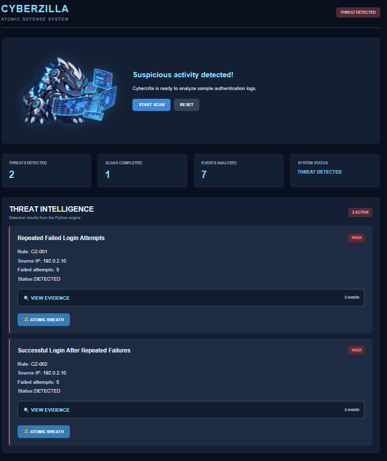

<p align="center">
  
</p>

<p align="center">
  <strong>Authentication events. Clear evidence. Better questions.</strong><br />
  A cybersecurity learning project by Marco Aguilar.
</p>

<p align="center">
  <a href="#quick-start">Quick start</a> ·
  <a href="#detection-rules">Detection rules</a> ·
  <a href="docs/BEGINNER_GUIDE.md">Beginner guide</a> ·
  <a href="#meet-the-birds">Meet the birds</a> ·
  <a href="#roadmap">Roadmap</a>
</p>

---

## Meet TaTo

**TaTo helps explain how security monitoring turns login records into findings worth investigating.** It uses Python rules to look for repeated authentication failures and a successful login following repeated failures, then returns the evidence through a FastAPI service to a Vue dashboard.

Imagine five failed sign-in attempts from one IP address in less than a minute. That may be someone mistyping a password—or activity worth investigating. TaTo highlights the pattern and shows the records behind it. The analyst still decides what it means.

**TaTo stands for Threat Analysis & Tracking Observatory.** Its name also comes from my family: **Tato is how my daughter refers to her brother, Anthony.** The acronym describes the project's direction: analyze suspicious patterns, keep track of the evidence, and give the user a clear place to review it.

> **Migration status:** This repository is transitioning from **Cyberzilla to TaTo**. The documentation introduces the new identity; the checked-in application still uses the earlier name, kaiju artwork, and `CZ-` rule IDs. The newer Windows-event workflow is not included in this repository yet. The instructions below describe the code that is actually checked in.

## Meet the birds

The characters are inspired by my children, **Anthony and Emily**. They give the project a personal identity and make its security workflow easier to follow: **Tato explores; Emeni takes a closer look.**

<table>
  <tr>
    <th align="center" width="50%">Tato · The curious explorer</th>
    <th align="center" width="50%">Emeni · The determined reviewer</th>
  </tr>
  <tr>
    <td align="center"></td>
    <td align="center"></td>
  </tr>
  <tr>
    <td align="center"><strong>Inspired by Anthony</strong><br />Adventurous, curious, and always ready to discover something.</td>
    <td align="center"><strong>Inspired by Emily</strong><br />A small bird with a strong personality and a confident attitude.</td>
  </tr>
</table>

### Tato: start with curiosity

Tato brings Anthony's adventurous spirit into the project. His role in the TaTo design is **scanning**: he takes out his magnifying glass and explores the records, representing the first step in understanding what happened.

In plain language: when you ask TaTo to scan, Tato represents the program looking through the events. The Python detector performs the actual rule checks.

His **sky-blue feathers** carry the project's blue accent into the character. In this visual identity, blue represents observation, calm, and curiosity. His backward black cap adds a playful, ready-for-an-adventure look.

### Emeni: pay attention to the evidence

Emeni is inspired by Emily, her family nickname, and her strong personality. Her role in the TaTo design is **reviewing suspicious findings**: looking more closely at what Tato discovered and bringing the user's attention to the evidence.

In plain language: Tato looks through the records; Emeni represents the moment to ask, “Why was this flagged?” A finding still needs a person's judgment, and Emeni does not independently confirm that an attack happened.

Her **pink feathers** establish the project's second accent color and distinguish her review role from Tato's scanning role. The **black biker jacket** expresses confidence and determination. Pink is part of her identity, rather than an alert severity level.

### One family, one visual identity

| Visual element | Meaning in the TaTo design |
| --- | --- |
| Sky blue / cyan | Tato's curiosity and the scanning stage |
| Pink | Emeni's personality and the review stage |
| Dark background | A consistent workspace that lets the characters and evidence stand out |
| Shield in the banner | The project's cybersecurity focus |
| Marco's bird avatar | The creator welcoming the user, leaning on the shield and facing the viewer |
| BY MARCO AGUILAR | The author behind the project and its development |

These are design meanings chosen for this project. **The birds communicate workflow stages; alert labels and evidence communicate security findings.** A blue or pink character does not mean a computer is safe or compromised.

> **Implementation status:** This section introduces the TaTo characters and their intended dashboard roles. The application checked into this repository still uses the earlier Cyberzilla artwork. Adding these portraits to the README does not replace the dashboard animations or add security controls.

## At a glance

| Area | What is available here |
| --- | --- |
| Input | A bundled JSON file with seven synthetic login events |
| Detection | Two Python rules using a 60-second window |
| Evidence | Timestamps, source IPs, usernames, and matching events |
| API | FastAPI with a health check and a sample scan endpoint |
| Interface | Vue dashboard, JSON result viewer, report export, and response animation |
| Validation | Five existing pytest tests and a GitHub Actions workflow |
| Response | Visual demonstration only; no firewall or account changes |

## What you can explore

- **Follow an authentication sequence:** See how individual records form a suspicious pattern.
- **Inspect supporting evidence:** Read the exact events associated with each rule match in the API result.
- **Compare detection rules:** Understand why failures grouped by IP differ from failures grouped by IP and username.
- **Read a structured report:** Explore the JSON returned by the backend or exported by the dashboard.
- **Walk through a response demo:** Watch a simulated containment and recovery sequence while the findings remain available.

> **Current input limitation:** The dashboard offers sample scenarios and a JSON editor, but the checked-in `POST /api/scan` handler does not consume that request body. It always analyzes `backend/sample_logs/auth_events.json`. Choosing “Normal activity” or pasting different events therefore does **not** change this backend's findings. To test different data in this version, edit the sample file as described in the [beginner guide](docs/BEGINNER_GUIDE.md#try-a-normal-login).

## Detection rules

The existing rule IDs are preserved so code, tests, and reports remain consistent during the rename.

| Rule | What triggers it | Grouping | Result |
| --- | --- | --- | --- |
| **CZ-001** · Repeated failed logins | At least five failed logins within 60 seconds | Source IP, across usernames | HIGH finding with failure evidence |
| **CZ-002** · Success after failures | A successful login with at least five preceding failures still inside the 60-second window | Same source IP **and** username | HIGH finding including the successful login |

**Example:** Failures at `10:00:00`, `:10`, `:20`, `:30`, and `:40`, followed by a success at `:50`, from the same IP and username, trigger both rules.

The bundled dataset adds one unrelated successful login, for **seven events and two findings**. Those two findings describe overlapping activity; they are not evidence of two separate attackers.

Implementation details:

- A gap of exactly 60 seconds remains inside the window; older events are removed.
- CZ-001 emits at most one finding per IP per scan.
- CZ-002 emits at most one finding per IP/username pair per scan. A success clears that account's current failure sequence.
- `HIGH` is the rule's configured severity, not a probability that a compromise occurred.

## How the pieces fit

| Component | Responsibility | Source |
| --- | --- | --- |
| JSON dataset | Stores the authentication records used by the current API | [Sample events](backend/sample_logs/auth_events.json) |
| Python detector | Validates and sorts file events, evaluates rules, builds evidence | [Detection engine](backend/detector.py) |
| FastAPI service | Loads the sample file and returns scan findings | [API](backend/api.py) |
| Vue dashboard | Requests a scan, displays results, exports JSON, animates a response demo | [Dashboard](frontend/src/App.vue) |
| Vite development server | Serves the frontend and proxies `/api` to port 8000 | [Vite configuration](frontend/vite.config.js) |
| pytest / GitHub Actions | Checks selected detection behaviors locally and in CI | [Tests](tests/test_detector.py) · [Workflow](.github/workflows/python-tests.yml) |

The API and dashboard run as **two separate processes**. The Vite proxy connects them during local development.

## Quick start

These commands use **Windows PowerShell**. For explanations, troubleshooting, and a normal-login experiment, open the [beginner guide](docs/BEGINNER_GUIDE.md).

### 1. Check your tools

Install Git, Python **3.12** (the CI version), and a Node.js version supported by `frontend/package.json`: `^22.18.0 || >=24.12.0`. Node **24.12 or later in the 24.x series** is a straightforward choice.

```powershell
git --version
python --version
node --version
npm --version
```

### 2. Download the repository

The repository URL still uses its original name. Clone it into a local folder named `TaTo`:

```powershell
git clone https://github.com/marcoas19/Cyberzilla.git TaTo
cd TaTo
```

Already have a checkout? Use that folder instead. Preserve any local work before pulling changes; the local Windows-event implementation may be newer than this repository.

### 3. Start the backend — terminal one

From the `TaTo` folder:

```powershell
cd backend
python -m venv .venv
.\.venv\Scripts\python.exe -m pip install -r requirements.txt
.\.venv\Scripts\python.exe -m uvicorn api:app --reload --host 127.0.0.1 --port 8000
```

Keep this terminal open. Visit [the API documentation](http://127.0.0.1:8000/docs), expand **POST /api/scan**, select **Try it out**, then **Execute**. The sample scan should return `total_events: 7` and `threats_detected: 2`.

### 4. Start the dashboard — terminal two

Open another PowerShell window in the `TaTo` folder:

```powershell
cd frontend
npm ci
npm run dev
```

Open the address printed by Vite, usually [http://localhost:5173](http://localhost:5173). Select **Start scan**, inspect **View full API result**, and try **Export JSON** or **Simulate response**.

The interface still shows Cyberzilla during the migration. The response sequence is an animation; it does not alter the computer, source events, or detection result.

### 5. Stop the application

Press **Ctrl+C** in each terminal when finished.

## API reference

| Method | Endpoint | Behavior |
| --- | --- | --- |
| GET | `/` | Reports the legacy application name, version, and online status |
| POST | `/api/scan` | Analyzes the bundled JSON file; accepts no modeled event input |
| GET | `/docs` | Opens FastAPI's interactive documentation |

Test the scan from a third PowerShell terminal:

```powershell
Invoke-RestMethod -Method Post -Uri http://127.0.0.1:8000/api/scan |
    ConvertTo-Json -Depth 10
```

| Response field | Meaning |
| --- | --- |
| `status` | Whether the scan completed |
| `timestamp` | When the API generated the report, in UTC |
| `total_events` | Number of records loaded from the sample file |
| `threats_detected` | Number of rule findings, which may overlap |
| `threats` | Findings, descriptions, timestamps, and supporting evidence |
| `mode` | `SAMPLE_LOG_ANALYSIS` in the checked-in implementation |

Within a finding, `attempts` counts failures. CZ-002's `evidence` also includes the successful login, so five attempts can have six evidence records. `response: NOT_EXECUTED` means no system response was performed.

## Run the existing tests

From the repository root, after installing the backend dependencies:

```powershell
.\backend\.venv\Scripts\python.exe -m pytest -v
```

The five tests cover repeated failures, success after failures, a normal login, failures outside the window, and separation of different usernames for CZ-002. They do not validate the complete dashboard/API integration or Windows log collection.

## Scope and limitations

TaTo is an educational security-monitoring prototype. Its findings are leads for investigation.

- The checked-in API reads a sample file; live Windows Security log collection is not included yet.
- A rule match does not prove an attack. No matches do not prove a system is safe.
- The response demo does not block IPs, disable accounts, remove malware, or end sessions.
- The file loader expects valid IP addresses, usernames, supported event types, and compatible ISO timestamps. Missing-IP accounting from the newer TaTo workflow is not implemented here.
- Loopback addresses such as `127.0.0.1` and `::1` refer to the local computer; they do not identify a remote attacker. This detector does not label them separately.
- The API has no authentication layer; this guide runs it on the local loopback address.
- The dashboard keeps activity in the current browser session; there is no persistent investigation database.

## Roadmap

| Stage | Next work |
| --- | --- |
| Identity | Bring the dashboard, API labels, assets, and repository name into the TaTo identity |
| Input accuracy | Align the frontend request with an API that validates and analyzes submitted events |
| Windows workflow | Sync and test the newer local event collector and TaTo report format |
| Clear reporting | Explain skipped events, missing source IPs, loopback activity, and response actions |
| Investigation | Add persistent scan history, analyst notes, and useful filters |
| Demo polish | Replace the legacy screenshot and artwork with the completed TaTo dashboard |

These are planned improvements, not features promised by the current checkout.

<details>
<summary><strong>View the earlier Cyberzilla dashboard</strong></summary>

This screenshot documents the earlier visual identity. It is not a preview of the finished TaTo design.



</details>

## About the author

**Marco Aguilar** — cybersecurity student building practical skills in Python, authentication-log analysis, detection engineering, API development, and clear security communication.

This project gives me a way to connect the technical work with a simple question: **Can I explain why a finding appeared and show the evidence behind it?**

## Acknowledgments

To my wife, **Lady**: thank you for your love, patience, and encouragement. Your thoughtful questions push me to understand what I build and explain it clearly.

To my children, **Anthony and Emily**: you are my greatest motivation to keep learning. TaTo and Emeni bring a little of our family into this project, and every step forward is part of building a better future for you.

To my parents, **Marco and Marta**: thank you for your love, sacrifices, and support. Your example helps me keep going through difficult moments and new challenges.

I also thank **ChatGPT (Moka)** for explanations, debugging assistance, and documentation support during development. I remain responsible for reviewing, understanding, and validating the project.

<p align="center"><strong>Built with curiosity. Inspired by family.</strong><br />TaTo · Marco Aguilar</p>
